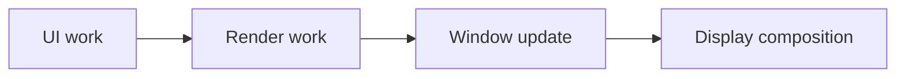
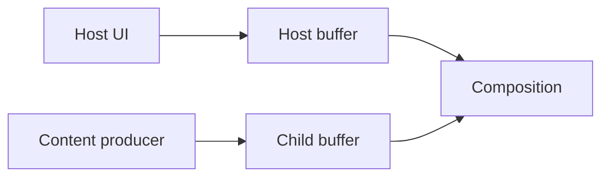
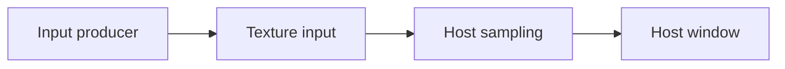

GENERATED FILE - DO NOT EDIT.
Source: backend/skills/pipelines/index.yaml
Source SHA-256: 95daa11fd5f562109953d1d312994489abee14d53c526e5f840b85544ae84c23

# Rendering teaching cards

These concise product cards describe reference topology and evidence boundaries. They are guidance, not proof that a path occurred in a trace.

## Pipeline lookup

| Pipeline | Teaching card |
| --- | --- |
| ` ANDROID_PIP_FREEFORM ` | [S06_MULTI_WINDOW](#s06_multi_window) |
| ` ANDROID_VIEW_MIXED ` | [S05_MIXED_RENDERING](#s05_mixed_rendering) |
| ` ANDROID_VIEW_MULTI_WINDOW ` | [S06_MULTI_WINDOW](#s06_multi_window) |
| ` ANDROID_VIEW_SOFTWARE ` | [S07_SOFTWARE_OFFSCREEN](#s07_software_offscreen) |
| ` ANDROID_VIEW_STANDARD_BLAST ` | [S02_AOSP_STANDARD](#s02_aosp_standard) |
| ` ANDROID_VIEW_STANDARD_LEGACY ` | [S02_AOSP_STANDARD](#s02_aosp_standard) |
| ` ANGLE_GLES_VULKAN ` | [S08_NATIVE_GRAPHICS](#s08_native_graphics) |
| ` CAMERA_PIPELINE ` | [S11_CAMERA](#s11_camera) |
| ` CHROME_BROWSER_VIZ ` | [S16_CHROMIUM_BROWSER](#s16_chromium_browser) |
| ` COMPOSE_STANDARD ` | [S02_AOSP_STANDARD](#s02_aosp_standard) |
| ` FLUTTER_SURFACEVIEW_IMPELLER ` | [S10_FLUTTER](#s10_flutter) |
| ` FLUTTER_SURFACEVIEW_SKIA ` | [S10_FLUTTER](#s10_flutter) |
| ` FLUTTER_TEXTUREVIEW ` | [S10_FLUTTER](#s10_flutter) |
| ` GAME_ENGINE ` | [S13_GAME](#s13_game) |
| ` HARDWARE_BUFFER_RENDERER ` | [S07_SOFTWARE_OFFSCREEN](#s07_software_offscreen) |
| ` IMAGEREADER_PIPELINE ` | [S07_SOFTWARE_OFFSCREEN](#s07_software_offscreen) |
| ` OPENGL_ES ` | [S08_NATIVE_GRAPHICS](#s08_native_graphics) |
| ` RN_NEW_ARCH_HWUI ` | [S14_REACT_NATIVE](#s14_react_native) |
| ` RN_OLD_ARCH_HWUI ` | [S14_REACT_NATIVE](#s14_react_native) |
| ` RN_SKIA_RENDERER ` | [S14_REACT_NATIVE](#s14_react_native) |
| ` SOFTWARE_COMPOSITING ` | [S01_OVERVIEW](#s01_overview) |
| ` SURFACEVIEW_BLAST ` | [S03_SURFACEVIEW](#s03_surfaceview) |
| ` SURFACE_CONTROL_API ` | [S07_SOFTWARE_OFFSCREEN](#s07_software_offscreen) |
| ` TEXTUREVIEW_STANDARD ` | [S04_TEXTUREVIEW](#s04_textureview) |
| ` VARIABLE_REFRESH_RATE ` | [S01_OVERVIEW](#s01_overview) |
| ` VIDEO_OVERLAY_HWC ` | [S12_VIDEO_OVERLAY_HWC](#s12_video_overlay_hwc) |
| ` VULKAN_NATIVE ` | [S08_NATIVE_GRAPHICS](#s08_native_graphics) |
| ` WEBVIEW_GL_FUNCTOR ` | [S09_WEBVIEW](#s09_webview) |
| ` WEBVIEW_SURFACEVIEW_WRAPPER ` | [S09_WEBVIEW](#s09_webview) |
| ` WEBVIEW_SURFACE_CONTROL ` | [S09_WEBVIEW](#s09_webview) |
| ` WEBVIEW_TEXTUREVIEW_CUSTOM ` | [S09_WEBVIEW](#s09_webview) |

## 渲染路径与证据范围

- Rendering type: ` S01_OVERVIEW `
- Kind: ` overview `

先定位内容生产者、接收方及输出目标，再判断所选时间窗中的路径。类型候选用于导航，实际交接依赖同一对象与时间证据。

### Thread roles

| Thread | Responsibility | Trace tag |
| --- | --- | --- |
| Producer | 生成内容并提交资源引用 |  |
| Consumer | 遵守输入依赖并使用资源 |  |

### Key slices

- ` queueBuffer `
- ` BLASTBufferQueue `
- ` setTransactionState `

## 标准窗口与 HWUI

- Rendering type: ` S02_AOSP_STANDARD `
- Kind: ` concrete `

主线程组织界面状态，RenderThread 执行绘制工作并提交窗口内容。CPU 切片、GPU 完成及显示反馈分别测量，不累加为同一个串行耗时。

### Thread roles

| Thread | Responsibility | Trace tag |
| --- | --- | --- |
| main | 输入、布局及绘制状态更新 |  |
| RenderThread | 绘制执行与 GPU 提交 |  |
| surfaceflinger | 处理层更新并组织显示合成 |  |

### Key slices

- ` Choreographer#doFrame `
- ` DrawFrame `
- ` syncFrameState `
- ` queueBuffer `

## 独立 Surface 内容

- Rendering type: ` S03_SURFACEVIEW `
- Kind: ` concrete `

宿主界面与独立内容可以有不同生产节奏。区分容器属性和真正承载 buffer 的子层，沿活动 layer 关联提交及显示。

### Thread roles

| Thread | Responsibility | Trace tag |
| --- | --- | --- |
| main | 管理宿主界面与 Surface 生命周期 |  |
| Producer thread | 向独立输出提交内容 |  |
| surfaceflinger | 组合宿主及独立内容层 |  |

### Key slices

- ` queueBuffer `
- ` BLASTBufferQueue `
- ` setTransactionState `

## 纹理输入与宿主采样

- Rendering type: ` S04_TEXTUREVIEW `
- Kind: ` concrete `

外部输入先由宿主取用，再写入宿主窗口输出。输入资源与窗口 buffer 各有完成和回收依赖；通知到达不等于已经采样或呈现。

### Thread roles

| Thread | Responsibility | Trace tag |
| --- | --- | --- |
| Producer thread | 生成外部纹理内容 |  |
| RenderThread | 获取输入并提交宿主采样工作 |  |

### Key slices

- ` ASurfaceTexture_dequeueBuffer `
- ` updateTexImage `
- ` queueBuffer `
- ` DrawFrame `

## 多路内容与同步

- Rendering type: ` S05_MIXED_RENDERING `
- Kind: ` concrete `

逐路说明哪些内容回流到宿主、哪些形成独立层。事务可同步已加入的状态，跨内容业务版本是否一致需要单独的身份映射。

### Thread roles

| Thread | Responsibility | Trace tag |
| --- | --- | --- |
| main | 协调宿主与参与同步的窗口状态 |  |
| Producer thread | 独立推进各路内容 |  |

### Key slices

- ` SurfaceSyncGroup `
- ` BLASTBufferQueue `
- ` setTransactionState `
- ` queueBuffer `

## 多窗口的共享与隔离

- Rendering type: ` S06_MULTI_WINDOW `
- Kind: ` concrete `

窗口可以共享执行线程，但输出队列及资源释放分别管理。保留窗口、进程实例与 layer 身份，短绘制仍可能因共享线程排队而迟到。

### Thread roles

| Thread | Responsibility | Trace tag |
| --- | --- | --- |
| main | 执行所在 Looper 的窗口回调 |  |
| RenderThread | 承载同进程窗口的绘制工作 |  |

### Key slices

- ` Choreographer#doFrame `
- ` DrawFrame `
- ` queueBuffer `

## 软件生产与离屏结果

- Rendering type: ` S07_SOFTWARE_OFFSCREEN `
- Kind: ` concrete `

区分 CPU Surface 生产、View 软件缓存、GPU 离屏和直接 buffer 提交。离屏结果以消费者可读为完成边界，不要求物理显示反馈。

### Thread roles

| Thread | Responsibility | Trace tag |
| --- | --- | --- |
| Producer thread | 执行 CPU 或离屏生产并交接结果 |  |
| RenderThread | 可能承载宿主绘制或离屏工作 |  |

### Key slices

- ` lock `
- ` unlock `
- ` buildDrawingCache/SW Layer `
- ` queueBuffer `

## 原生图形提交

- Rendering type: ` S08_NATIVE_GRAPHICS `
- Kind: ` concrete `

沿引擎的获取、提交及输出阶段定位等待。长 swap/acquire 可能是资源复用或主动节奏控制；缺少 Vulkan tracing 切片时保留可见性限制。

### Thread roles

| Thread | Responsibility | Trace tag |
| --- | --- | --- |
| Render thread | 录制并提交原生图形工作 |  |
| GPU | 执行已提交的图形命令 |  |

### Key slices

- ` eglSwapBuffers `
- ` vkQueuePresentKHR `
- ` queueBuffer `
- ` dequeueBuffer `

## WebView 宿主绘制

- Rendering type: ` S09_WEBVIEW `
- Kind: ` concrete `

分别观察网页内容生产与宿主 functor 执行。网页资源、functor 调用和宿主窗口帧不是同一计数；视频独立层可与宿主路径并存。

### Thread roles

| Thread | Responsibility | Trace tag |
| --- | --- | --- |
| CrRendererMain | 执行网页渲染及脚本工作 |  |
| RenderThread | 执行宿主 functor 与窗口绘制 |  |

### Key slices

- ` DrawFn_DrawGL `
- ` DrawFn_DrawVk `
- ` WebViewFunctor::drawVk `
- ` WebViewFunctor::drawGl `
- ` WebViewFunctor::sync `
- ` WebViewFunctor::postDrawVk `

## Flutter 内容与 Android 输出

- Rendering type: ` S10_FLUTTER `
- Kind: ` concrete `

分别确认引擎工作、根输出承载和嵌入内容。线程职责可能合并；raster 结束不代表 GPU 或显示完成，纹理输出还要追宿主采样。

### Thread roles

| Thread | Responsibility | Trace tag |
| --- | --- | --- |
| UI task runner | 推进框架及界面工作，线程名随版本变化 |  |
| Raster task runner | 执行场景绘制与输出提交 |  |

### Key slices

- ` Animator::BeginFrame `
- ` Rasterizer::Draw `
- ` queueBuffer `
- ` ASurfaceTexture_dequeueBuffer `

## 相机输入与多路消费

- Rendering type: ` S11_CAMERA `
- Kind: ` concrete `

请求、结果元数据和输出 buffer 分别关联。预览、分析及录像可能互相回压；需要资源持有和释放证据才能确认消费端阻塞。

### Thread roles

| Thread | Responsibility | Trace tag |
| --- | --- | --- |
| Camera request thread | 组织相机请求，名称可能截断 |  |
| Camera consumer | 使用并释放各路输出资源 |  |

### Key slices

- ` Camera `
- ` CaptureSession `
- ` queueBuffer `

## 视频输出与显示合成

- Rendering type: ` S12_VIDEO_OVERLAY_HWC `
- Kind: ` concrete `

媒体时间、buffer 提交及目标显示分别关联。低于面板频率的内容可以正常复用；是否采用 DEVICE 合成需要目标视频层的逐帧证据。

### Thread roles

| Thread | Responsibility | Trace tag |
| --- | --- | --- |
| Codec thread | 推进解码输出及资源交接 |  |
| surfaceflinger | 组织视频与其他层的显示合成 |  |

### Key slices

- ` releaseOutputBuffer `
- ` queueBuffer `
- ` present `

## 引擎流水与帧节奏

- Rendering type: ` S13_GAME `
- Kind: ` concrete `

保留逻辑帧、渲染帧、GPU 提交及输出图像的映射。流水重叠不能直接相加；空闲图像数或 pending 水位不能证明未来完整画面库存。

### Thread roles

| Thread | Responsibility | Trace tag |
| --- | --- | --- |
| Game thread | 推进游戏逻辑与场景状态 |  |
| Render thread | 准备并提交渲染工作 |  |

### Key slices

- ` eglSwapBuffers `
- ` vkQueuePresentKHR `
- ` queueBuffer `

## React Native 更新与宿主窗口

- Rendering type: ` S14_REACT_NATIVE `
- Kind: ` concrete `

JS、Fabric/Paper 阶段和宿主绘制分别取证。线程别名不能单独证明架构，Commit/Mount 次数也不能替代实际窗口帧数。

### Thread roles

| Thread | Responsibility | Trace tag |
| --- | --- | --- |
| mqt_js / mqt_v_js | 执行 JS 工作，名字不决定架构 |  |
| main | 应用原生界面更新并推进宿主绘制 |  |

### Key slices

- ` FabricUIManager `
- ` FabricCommit `
- ` FabricMount `
- ` Choreographer#doFrame `
- ` DrawFrame `

## 浏览器多进程出图

- Rendering type: ` S16_CHROMIUM_BROWSER `
- Kind: ` concrete `

按 Browser、Renderer 与 Viz/GPU 的实际归属建链。内部 category 不可见时保留缺口；输出可能经 BQ/BLAST，也可能直接提交 SurfaceControl。

### Thread roles

| Thread | Responsibility | Trace tag |
| --- | --- | --- |
| CrBrowserMain | 浏览器控制与界面工作 |  |
| CrRendererMain | 网页渲染工作 |  |
| VizCompositorTh* | 浏览器合成与输出，线程名可能截断 |  |

### Key slices

- ` Graphics.Pipeline `
- ` queueBuffer `
- ` setTransactionState `
